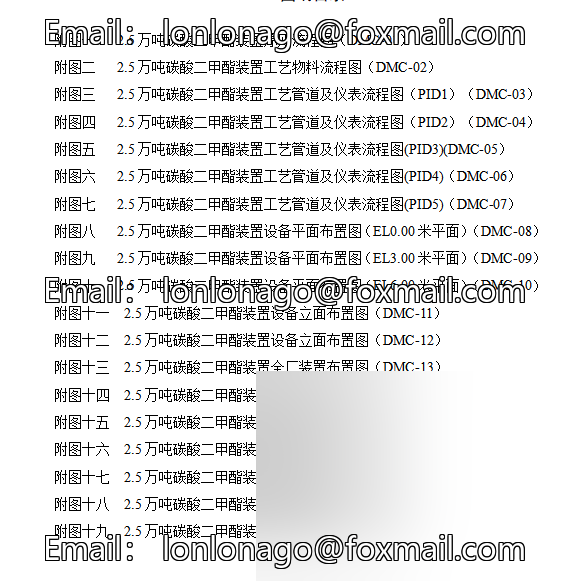
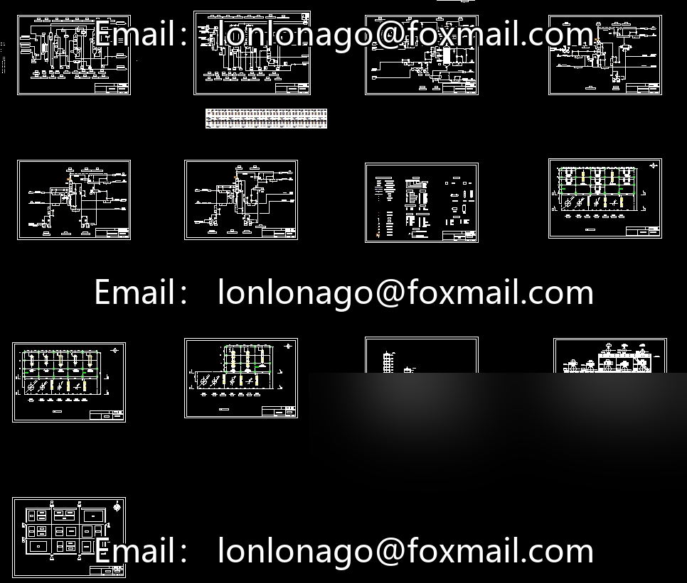
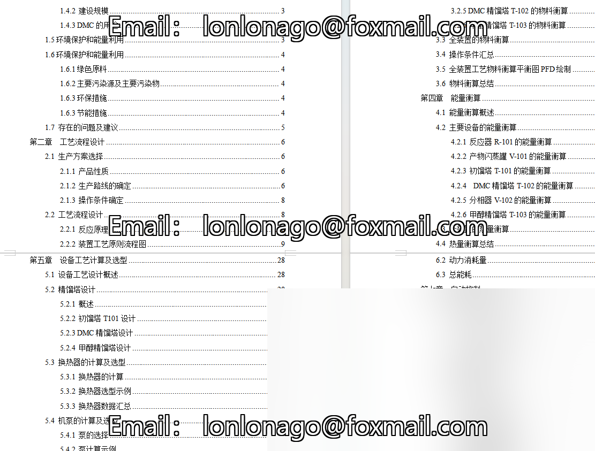

# Pharmaceutical dimethyl carbonate process CAD design drawing

## Body

Carbon dimethylate process CAD design chart 259 Carbon dimethylate production unit process design Carbon dimethylate process design Carbon dimethylate process design chart Carbon dimethylate process design CAD diagram Carbon dimethylate process design and others

The design includes CAD diagrams, 3D source files, simulation files, and various process flow diagrams and layout drawings for the DMC process.

<!-- AI_ENRICHED -->

## Images

## Payment

Here is a pay link on Stripe ( https://buy.stripe.com/3cs8yP7sY87d0vu9AB ). Please contact me lonlonago@foxmail.com after funding $89, and I will send you a complete data files , thank you!

